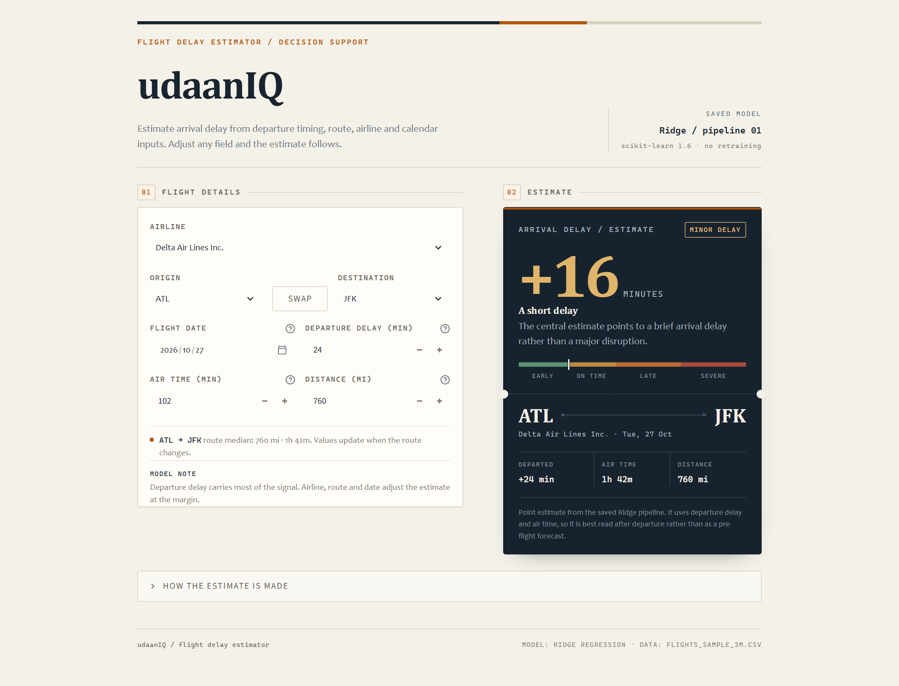

# udaanIQ

**Flight Delay Estimator** — a Streamlit prototype that estimates arrival delay from a saved scikit-learn pipeline.



## Overview

udaanIQ is an academic project that turns a trained flight-delay model into a small, usable interface. It loads `flight_delay_best_model.pkl` directly and scores one flight at a time. The app does not train or tune a model at runtime.

The model uses departure delay and air time, which are only known after a flight has left the gate. This makes Delay Desk a **post-departure estimate**, not a pre-flight forecast. The output is a point estimate in minutes, not a probability.

## Features

- Live arrival-delay estimate as fields change
- Airline, origin, destination, date, departure delay, air time and distance inputs
- Route-aware defaults: air time and distance are pre-filled from historical medians
- Origin/destination swap and route validation
- Colour-coded severity scale from early to severe
- Ticket-style result card with route, airline and delay context
- Transparent model and scope notes in the interface
- No API keys, external services or live data calls

## How the model works

| Item | Detail |
|---|---|
| Target | `ARR_DELAY` in minutes |
| Estimator | Ridge regression |
| Numeric preprocessing | Median imputation, then standardisation |
| Categorical preprocessing | Most-frequent imputation, then one-hot encoding |
| Input features | `DEP_DELAY`, `AIR_TIME`, `DISTANCE`, `MONTH`, `DAY_OF_WEEK`, `AIRLINE`, `ORIGIN`, `DEST` |
| Saved artifact | `flight_delay_best_model.pkl` |

The companion notebook compares Linear Regression, Ridge, Lasso, Decision Tree and Random Forest, then saves the model with the lowest test RMSE. The included artifact is a Ridge pipeline.

On the notebook's 30,000-row comparison sample (24,000 training rows and 6,000 test rows), Ridge scored MAE 8.04 min, RMSE 11.55 min and R² 0.954.

## Run locally

Tested with Python 3.12.9. Scikit-learn is pinned to `1.6.1` because the saved pipeline was created with that version.

### Windows (PowerShell)

```powershell
py -3.12 -m venv .venv
.\.venv\Scripts\Activate.ps1
python -m pip install -r requirements.txt
streamlit run app.py
```

### macOS / Linux

```bash
python3.12 -m venv .venv
source .venv/bin/activate
python -m pip install -r requirements.txt
streamlit run app.py
```

The app opens at `http://localhost:8501`.

## Dataset

The analysis uses `flights_sample_3m.csv`, a sample of US domestic flight records. The CSV is about 614 MB and is excluded from version control.

- **Notebook:** upload `flights_sample_3m.csv` to Colab at `/content/flights_sample_3m.csv`, or update the notebook's read path.
- **App:** the app runs without the CSV, but route auto-fill is disabled. Place the CSV in the project root to pre-fill air time and distance from historical medians.

The route lookup reads the first 400,000 rows and computes median distance and air time per origin–destination pair. It does not train anything.

## Notebook

`B3_B4_53_PranjalSorte_SI_Project.ipynb` is the supporting analysis notebook, written for Google Colab. It covers:

- Web-scraping exercise with FlightAware
- Data cleaning and descriptive statistics
- Probability, sampling and the Central Limit Theorem
- Confidence intervals and bootstrap estimation
- One-sample, two-sample, paired tests, ANOVA and chi-square
- Covariance, Pearson and Spearman correlation
- Encoding, scaling and leakage-safe preprocessing
- Comparison of five regression models
- Saving the best comparison model and preprocessing artifacts

The app dependencies are pinned in `requirements.txt`. The notebook also uses SciPy, Matplotlib and Seaborn; install those separately if you want to run the analysis locally.

## Project structure

```text
.
├── app.py
├── assets/
│   └── app-preview.png
├── .streamlit/
│   └── config.toml
├── B3_B4_53_PranjalSorte_SI_Project.ipynb
├── flight_delay_best_model.pkl
├── flights_sample_3m.csv        # not committed
├── requirements.txt
├── .gitignore
└── README.md
```

## Limitations

- The model uses departure delay and air time, so it is best read after departure.
- Predictions are point estimates and do not include uncertainty intervals.
- The data covers US domestic flights; performance on other markets is unknown.
- Route medians are historical defaults, not live schedule or weather data.
- The model is static. It is not retrained by the app.

## Tested with

Python 3.12.9 · Streamlit 1.66.1 · scikit-learn 1.6.1 · pandas 2.2.3 · NumPy 2.5.4 · SciPy 1.18.1 · Joblib 1.6.0

## Author

Pranjal Sorte — Ramdeobaba University
